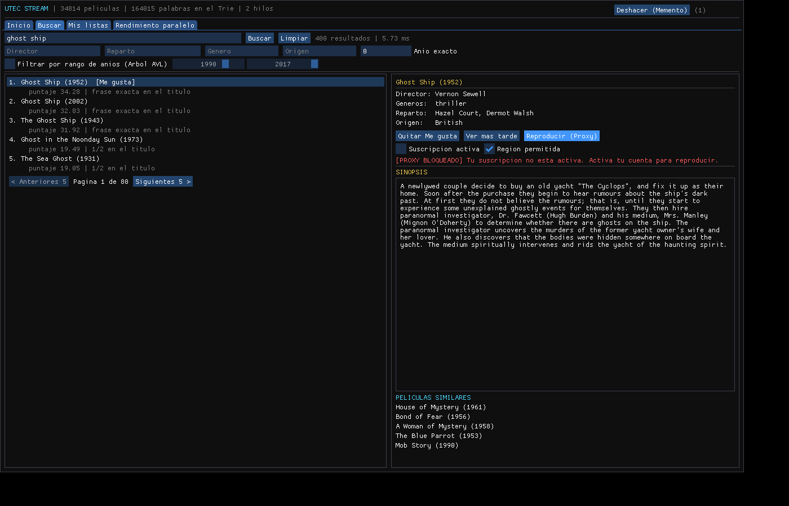
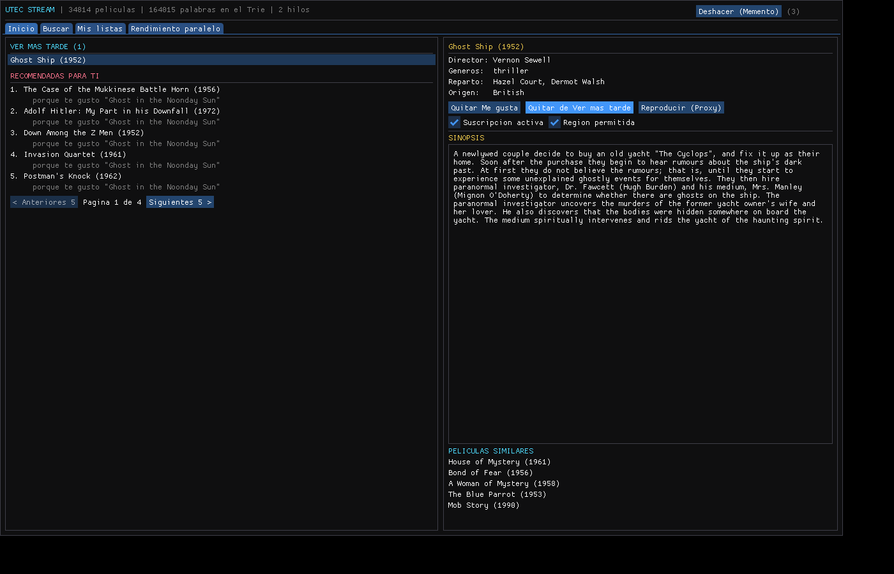
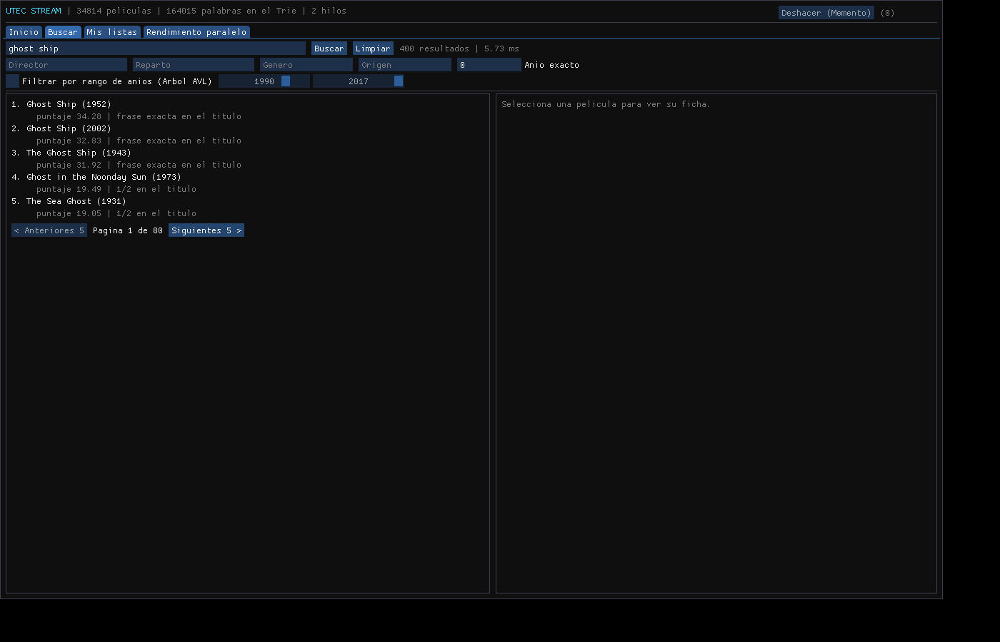
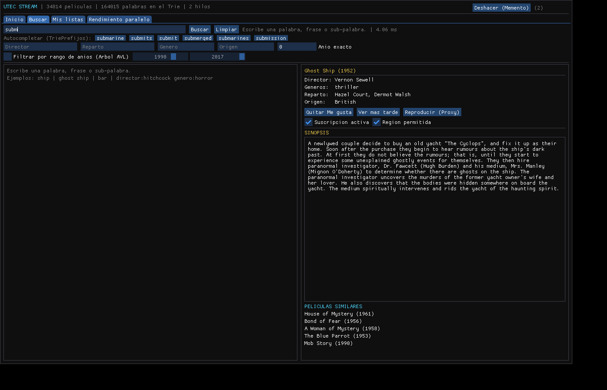
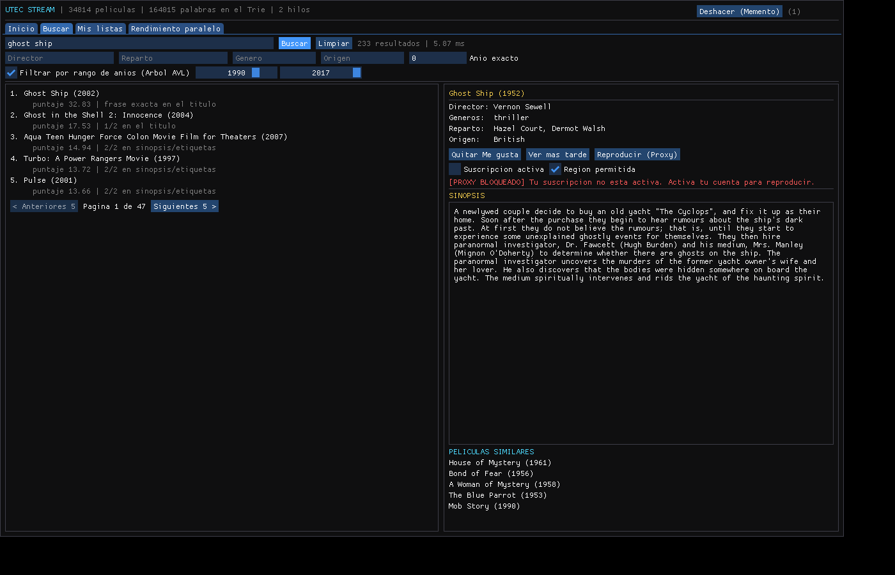

# UTEC Stream — Plataforma de streaming en C++

**Programación III (CS2013) · Proyecto Final 2026‑2 · UTEC**

Buscador de películas sobre el corpus *Wiki Movie Plots* (34 886 registros, 81 MB).
Permite buscar por palabra, frase o sub‑palabra, filtrar por etiquetas
(director, reparto, género, origen, año), marcar **Me gusta** y **Ver más tarde**,
y recibir recomendaciones basadas en similitud de contenido.

Todo el programa —lectura del CSV, pre‑procesamiento, estructuras de datos,
búsqueda, recomendación y paralelismo— está escrito en **C++17 sin dependencias
externas**. La única biblioteca de terceros es la de la interfaz gráfica
(Dear ImGui + GLFW), que CMake descarga solo.

## Integrantes

| Nombre y apellidos | Código | Responsabilidad principal |
|---|---|---|
| Alonso Gomez | 202420110 | Pre‑procesamiento y lector CSV |
| Alvaro Quispe | 202510375 | Tries e índice invertido |
| Adrian Varillas | 202510170 | Ranking y recomendaciones |
| Luciano Sanchez | 202420095 | Interfaz e integración |

---

## Entregable 2 — dónde está cada cosa

| Requisito | Archivo(s) | Sección |
|---|---|---|
| **4 patrones de diseño** (Singleton, Builder, Proxy, Memento) | `include/patrones.hpp`, `src/patrones.cpp` | [§12.2](#122-cuatro-patrones-de-diseño) |
| **Árbol** (TriePrefijos, TrieSufijos y Árbol AVL) | `include/trie.hpp`, `src/trie.cpp`, `include/arbol_avl.hpp`, `src/arbol_avl.cpp` | [§3](#3-justificación-de-la-estructura-de-árbol), [§12.1](#121-árboles) |
| **Programación paralela** en inserción y búsqueda de strings | `include/hilos.hpp`, `src/indice.cpp`, `src/buscador.cpp`, `src/paralelo.cpp` | [§12.3](#123-programación-paralela) |
| **Interfaz gráfica** (Dear ImGui) | `src/gui_main.cpp` | [§12.4](#124-interfaz-gráfica) |
| Pruebas de todo lo anterior | `tests/pruebas.cpp` (110 pruebas) | [§12.5](#125-pruebas) |

---

## 1. Cómo compilar y ejecutar

### 1.1 Descargar el dataset

El CSV **no está en el repositorio** (pesa 81 MB). Descárgalo desde:

**https://drive.google.com/file/d/1UJkRuCF8UD92W_DT7S8dXCYzaR_9wqB_/view?usp=sharing**

y guárdalo con este nombre exacto:

```
data/wiki_movie_plots_deduped.csv
```

### 1.2 Con CMake (recomendado: interfaz gráfica + consola + pruebas)

Requisitos: compilador C++17, CMake ≥ 3.16, Git y OpenGL. GLFW y Dear ImGui
se descargan solos la primera vez que se configura.

```bash
git clone <url-del-repositorio>
cd <repositorio>
cmake -S . -B build -DCMAKE_BUILD_TYPE=Release
cmake --build build -j

./build/streaming_gui                     # interfaz gráfica
./build/streaming                         # interfaz de consola
./build/pruebas                           # 110 pruebas
./build/streaming --benchmark             # 1 hilo vs N hilos
```

Los programas se pueden ejecutar **desde cualquier carpeta**: CMake les pasa
la ruta del repositorio (`PROYECTO_RAIZ`, ver `include/rutas.hpp`) y ahí buscan
`data/` y `tests/` si no los encuentran en la carpeta actual. El estado del
usuario (`datos_usuario.txt`) se guarda siempre en la raíz del repositorio.

**Con CLion:** *File → Open* → la carpeta del repositorio → *CMake project*.
CLion descarga ImGui y GLFW la primera vez y aparecen las configuraciones
`streaming_gui`, `streaming` y `pruebas`; no hace falta configurar el
*Working directory*. Para medir tiempos con `--benchmark`, agrega el perfil
**Release** en *Settings → Build, Execution, Deployment → CMake → +*; en
Debug el programa avisa que los tiempos no son representativos.

En Linux, GLFW necesita las cabeceras de X11 y OpenGL:

```bash
sudo apt install build-essential cmake git libgl1-mesa-dev xorg-dev
```

En Windows con Visual Studio, los ejecutables quedan en `build\Release\` (por ejemplo,
`build\Release\streaming_gui.exe`).

Si una máquina no tiene OpenGL, se puede compilar solo la consola y las pruebas:

```bash
cmake -S . -B build -DCONSTRUIR_GUI=OFF
```

### 1.3 Con Make (solo consola y pruebas, sin CMake)

```bash
make -j            # ./streaming
make pruebas       # ./pruebas
```

### 1.4 Argumentos

```bash
./build/streaming_gui [ruta_csv] [ruta_estado]
./build/streaming     [ruta_csv] [ruta_estado] [--sin-cache] [--benchmark [hilos]]
```

El estado del usuario (Me gusta, Ver más tarde, vistas) se guarda por defecto
en `datos_usuario.txt`. La primera ejecución construye los árboles (~3 s) y
escribe un caché binario junto al CSV (`data/wiki_movie_plots_deduped.csv.cache`,
201 MB, no se sube a GitHub). Desde la segunda, el arranque baja a ~1 s.
`--sin-cache` fuerza la reconstrucción desde el CSV.

---

## 2. Uso

**Interfaz gráfica:** ver [§12.4](#124-interfaz-gráfica).

**Consola:**

```
> ship                        búsqueda por palabra
> ghost ship                  búsqueda por frase
> shi                         búsqueda por sub-palabra
> director:hitchcock          búsqueda por etiqueta
> reparto:tom hanks
> genero:horror anio:1960     etiquetas combinadas
> m                           siguientes 5 coincidencias
> 3                           abre la ficha del resultado 3
> r                           mis recomendaciones
> i                           volver al inicio
> q                           salir
```

Dentro de una ficha: `l` = Me gusta, `v` = Ver más tarde, `s` = similares,
`Enter` = volver.

---

## 3. Justificación de la estructura de árbol

El enunciado exige un árbol cuyos nodos guarden caracteres y pide justificar la
elección. Usamos **dos tries** que se complementan.

### 3.1 Qué se descartó y por qué

| Alternativa | Por qué no |
|---|---|
| **Suffix tree / suffix array del texto completo** | El corpus tiene 75 MB de sinopsis y 13.3 M de tokens. Un suffix tree sobre el texto crudo necesitaría del orden de 10–20 bytes por carácter: **1–1.5 GB**, inviable en una laptop. |
| **Trie de prefijos únicamente** | Resuelve palabra y prefijo, pero no la búsqueda por sub‑cadena que pide el enunciado (`"bar"` dentro de `"bartender"`). |
| **Índice de k‑gramas (3‑gramas)** | Funciona, pero deja de ser un árbol de caracteres y falla con patrones de menos de *k* letras. |
| **Tabla hash del vocabulario** | O(1) para palabra exacta, pero no soporta prefijo ni sub‑cadena, y el enunciado pide un árbol. |

### 3.2 La decisión clave: indexar el **vocabulario**, no el texto

El texto tiene 13 353 866 tokens, pero solo **143 535 palabras distintas**
(1 074 389 caracteres). Insertar todos los sufijos del *vocabulario* cuesta
4 991 100 caracteres en el peor caso, unas **250 veces menos** que hacerlo sobre
el texto completo. El resultado medido son 947 941 nodos.

Se apoya en una equivalencia sencilla:

> Un patrón `P` aparece en un documento `D` **si y solo si** existe una palabra
> `T` del vocabulario que contiene a `P` y que además aparece en `D`.

Así, la búsqueda por sub‑cadena se descompone en dos pasos:
resolver `P → {términos}` en el árbol, y `término → {películas}` en el índice
invertido.

### 3.3 `TriePrefijos` — diccionario del vocabulario

Cada palabra distinta se inserta una vez y recibe un `idTermino`.
El nodo terminal guarda ese id. Resuelve:

* **palabra exacta** → descenso directo, **O(|palabra|)**;
* **prefijo** → descenso + recorrido del subárbol.

Este trie *es* el diccionario: no hay `unordered_map` de vocabulario en ninguna
parte del proyecto, ni siquiera durante la construcción del índice.

### 3.4 `TrieSufijos` — trie generalizado de sufijos del vocabulario

Para cada palabra `T` se insertan sus `|T|` sufijos y se marca cada nodo final
con el id de `T`. Entonces:

```
términos que contienen P  =  términos marcados en el subárbol al que se llega descendiendo P
```

porque `P` ocurre en `T` en la posición `i` ⟺ el sufijo `T[i..]` empieza con `P`.
Costo: **O(|P| + tamaño del subárbol)**.

### 3.5 Representación de los nodos

Los hijos son una **lista enlazada de hermanos**, no un arreglo indexado por
carácter:

```cpp
struct Nodo {
  int32_t primerHijo = -1;
  int32_t hermano    = -1;
  int32_t cabezaLista = -1;  // ó idTermino en el trie de prefijos
  uint8_t c = 0;             // el carácter del nodo
};                           // 16 bytes
```

Con un arreglo de 36 punteros por nodo, los ~1.33 M de nodos costarían más de
190 MB solo en punteros vacíos. Con lista de hermanos son **21 MB**. Como el
alfabeto normalizado es `[a-z0-9]` (36 símbolos), recorrer la lista es O(36) en
el peor caso y ~4 comparaciones por letra en la práctica (medido). Ese costo se
corrigió en la Parte 2 con nodos adaptativos (§3.6).

Los nodos viven en un `std::vector` y se referencian por índice `int32_t` en
lugar de punteros: la mitad de memoria en 64 bits y mucha mejor localidad de
caché.

### 3.6 Nodos adaptativos: lo que cuesta la lista de hermanos y cómo se corrigió

En la exposición de la Parte 1 nos hicieron dos observaciones correctas:

1. **No hace falta guardar 36 espacios por nodo.** Comparar contra un arreglo
   de 36 no basta: las alternativas reales guardan solo los hijos que existen
   (`std::map`, `std::unordered_map`, `std::vector` por nodo).
2. **Bajar por la lista de hermanos es más lento.** Desde `h`, para llegar a
   `e` hay que pasar por `i → o → e`; con un arreglo es un solo salto. Por eso
   "palabra exacta en O(|palabra|)" no era cierto: con la lista es
   O(|palabra| · σ), con σ = 36.

Lo medimos con el vocabulario real (164 015 palabras, TriePrefijos):

| Hijos de un nodo | 0 | 1 | 2 | 3 | 4+ |
|---|---|---|---|---|---|
| % de nodos | 30.2 % | **56.9 %** | 7.3 % | 2.4 % | 3.1 % |

| Cómo se guardan los hijos | Memoria | Buscar una palabra |
|---|---|---|
| Arreglo de 36 por nodo | 57.1 MB | ~60–110 ns |
| `std::unordered_map` por nodo | 59.1 MB | ~260–280 ns |
| `std::map` por nodo | 37.1 MB | ~360–380 ns |
| `std::vector<pair>` por nodo | 16.9 MB | ~180–220 ns |
| Lista de hermanos (Parte 1) | 6.2 MB | ~210–235 ns |
| **Nodos adaptativos (Parte 2)** | **7.9 MB** | **~60–90 ns** |

*(Solo el TriePrefijos; la memoria de los contenedores no incluye el costo
extra de cada `malloc`, que los perjudica aún más.)*

Las dos observaciones tenían razón. La lista de hermanos es la que menos
memoria usa: en un árbol de *n* nodos hay *n − 1* aristas, y cada nodo es
apuntado por **un solo** enlace (su padre o su hermano anterior), sin
reservas aparte. Pero el costo de recorrerla se concentra en **pocos nodos con
muchos hijos**: la raíz tiene 36 y cuesta ~9.7 comparaciones en promedio,
mientras que en los niveles profundos son ~1.7.

**La corrección (nodos adaptativos, `trie.hpp`):** al terminar de construir,
los nodos con **4 o más hijos** (el 3 %) reciben además una tabla de 36
índices y saltan al hijo en O(1). El resto sigue con la lista, que tiene como
máximo 3 elementos. El índice de la tabla se guarda en los 3 bytes de relleno
que el nodo ya tenía, así que **el nodo sigue midiendo 16 bytes**.

```cpp
template <typename N>
int32_t hijo(const std::vector<N> &nodos, const std::vector<TablaHijos> &tablas,
             int32_t padre, unsigned char c) {
  const int32_t d = indiceDenso(nodos[padre]);
  if (d != 0) return tablas[d - 1][simbolo(c)];              // nodo denso: O(1)
  for (int32_t h = nodos[padre].primerHijo; h != -1; h = nodos[h].hermano)
    if (nodos[h].c == c) return h;                            // a lo sumo 3 hermanos
  return -1;
}
```

Resultado con el dataset completo: buscar una palabra en el trie pasó de
~220 ns a ~80 ns (**~2.6x más rápido**), con 44 400 nodos densos entre los dos
tries (+6.4 MB). Ahora la búsqueda de palabra exacta es **O(|palabra|)
garantizado**. Los resultados de búsqueda son idénticos a los de antes, y
hay 6 pruebas que lo verifican.

Para ser honestos con la escala: bajar por el trie es una parte mínima de una
consulta (~0.0001 ms de 1–9 ms); el resto es recorrer las listas de películas.
La mejora corrige la complejidad del árbol, pero no cambia el tiempo de una
consulta completa.

---

## 4. Arquitectura

```
CSV (81 MB)
   │  csv.cpp          lector RFC 4180 (comillas escapadas, CRLF incrustados)
   ▼
Catalogo               limpieza, deduplicación, separación de reparto/géneros
   │  catalogo.cpp
   ▼
Indice                 tokeniza → TriePrefijos (ids) → listas de publicaciones
   │  indice.cpp       y luego llena el TrieSufijos con el vocabulario final
   ▼
Buscador               patrón → expansión en los tries → BM25F → re-ranking
   │  buscador.cpp
   ▼
Recomendador           perfil tf-idf del usuario → similitud del coseno
   │  recomendador.cpp
   ▼
main.cpp / gui_main.cpp   consola / interfaz grafica + EstadoUsuario
```

| Archivo | Responsabilidad |
|---|---|
| `normalizador.*` | Plegado UTF‑8→ASCII, limpieza de referencias `[12]`, tokenización, stopwords |
| `csv.*` | Lector CSV conforme a RFC 4180 |
| `catalogo.*` | Modelo `Pelicula` y todas las reglas de pre‑procesamiento |
| `trie.*` | `TriePrefijos` y `TrieSufijos` |
| `indice.*` | Índice invertido con campos, longitudes de documento, perfiles tf‑idf |
| `buscador.*` | Parseo de consultas, expansión léxica, BM25F, re‑ranking por frase |
| `recomendador.*` | Similares a una película y recomendaciones por perfil |
| `binario.hpp` | Serialización binaria en bloque para el caché |
| `estado_usuario.*` | Me gusta / Ver más tarde con persistencia en disco |
| `main.cpp` | Interfaz de consola (y `--benchmark`) |
| `gui_main.cpp` | Interfaz gráfica (Dear ImGui + GLFW + OpenGL 3) |
| `arbol_avl.*` | Árbol AVL de años para filtrar por rango |
| `patrones.*` | Singleton, Builder, Proxy y Memento |
| `hilos.hpp` | `paraleloPorBloques`: reparte un rango entre hilos |
| `rutas.hpp` | Encuentra `data/` y `tests/` aunque se ejecute desde la carpeta de compilación |
| `paralelo.*` | Búsqueda de lotes con un `Buscador` por hilo y benchmark |

---

## 5. Pre‑procesamiento

El CSV crudo trae problemas que rompen cualquier parser ingenuo. Estas son las
reglas aplicadas y lo que descartó cada una en la corrida real:

| Problema en el dato | Regla aplicada | Registros afectados |
|---|---|---|
| Comillas escapadas `""` y saltos `\r\n` dentro de `Plot` | Lector RFC 4180 real (no `split(',')` ni `getline`) | 23 425 sinopsis contenían CRLF |
| Referencias de Wikipedia `[1]`, `[cita requerida]` | Se eliminan en `limpiarTextoBruto` | 4 125 sinopsis |
| Tildes y diacríticos (`Fantôme`, `Ríos`) | Plegado UTF‑8 → ASCII, para que `capitan` encuentre `capitán` | 9 411 sinopsis, 417 títulos |
| `Director = "Unknown"` | Se traduce a campo vacío en vez de indexar la palabra "unknown" | 1 132 |
| `Genre = "unknown"` | Igual que arriba | 6 107 |
| `Cast` vacío (`NaN`) | Reparto vacío | 1 450 |
| `Cast` con separadores mixtos (`,`, `and`, `/`) | Se homogeneizan a coma y se separa | — |
| Título vacío | Se descarta la fila | 1 |
| Sinopsis de menos de 40 caracteres | Se descarta la fila | 30 |
| Filas duplicadas (mismo título + año + director) | Se descartan | 41 |

**34 814 películas útiles** de 34 886 filas leídas.

Nota sobre el apóstrofe: `don't` se normaliza como `dont` y no como `don` + `t`,
para no ensuciar el vocabulario con miles de tokens `t` y `s`.

---

## 6. Algoritmo de importancia (ranking)

El enunciado pide "un algoritmo para determinar qué película tiene más
importancia en una búsqueda". El nuestro tiene cuatro componentes.

### 6.1 Expansión léxica del patrón

Cada término de la consulta se resuelve contra los dos árboles y produce un
conjunto de términos del vocabulario, cada uno con un peso:

* **coincidencia exacta** (trie de prefijos): peso léxico `1.0`;
* **coincidencia por sub‑cadena** (trie de sufijos): peso
  `0.85 · (|P| / |T|)²`.

El cuadrado penaliza fuerte las coincidencias diluidas: para `P = "bar"`,
`T = "bar"` pesa 0.85 y `T = "bartender"` pesa 0.094.

### 6.2 Corrección del IDF en coincidencias parciales

Este fue el error más interesante que encontramos al probar. Buscando `ship`,
el top‑1 era una película cuyo único vínculo era un actor apellidado **Shipp**.
La causa: `shipp` aparece en 1 de 34 814 películas, así que su IDF es ~10, casi
cuatro veces el de `ship` (~2.9), y ese factor se comía la penalización léxica.

La corrección: **una coincidencia parcial no puede reclamar el IDF de su término
aislado**. Todas las expansiones de un patrón son *un solo concepto*, así que se
acota su IDF por el de la unión:

```
df_unión = Σ df(T)  sobre las expansiones
idf_tope = log(1 + (N − df_unión + 0.5) / (df_unión + 0.5))
idf_efectivo(T) = min( idf(T), idf_tope )
```

El patrón `ship` aparece en miles de películas (`relationship`, `friendship`,
`worship`…), así que discrimina poco y su tope es bajo. La coincidencia exacta
conserva su IDF completo. Después del arreglo, el top‑5 de `ship` son
*Flying Phantom Ship*, *Sail a Crooked Ship*, *The Devil‑Ship Pirates*,
*Ship Ahoy* y *Hell Ship Mutiny*.

### 6.3 BM25 con campos (BM25F)

Cada película es un documento con seis campos. La frecuencia efectiva pondera
dónde apareció el término:

```
tf' = 6·tf_título + 4·tf_etiquetas + 1·tf_sinopsis
```

y se aplica la saturación de BM25 (`k₁ = 1.2`, `b = 0.6`):

```
puntaje(T,D) = idf_efectivo(T) · tf'·(k₁+1) / (tf' + k₁·(1 − b + b·|D|/media))
```

BM25 y no TF‑IDF simple por dos razones: la **saturación** evita que una sinopsis
que repite `ship` veinte veces aplaste a un título que se llama *Ghost Ship*, y
la **normalización por longitud** compensa que las sinopsis van de 40 a 36 773
caracteres.

Cuando un término de consulta se expande a varios términos del vocabulario, el
aporte del término es el **máximo** entre sus expansiones, no la suma: si no,
`bar` sumaría cuatro veces en un documento que contiene *bar*, *barn*, *barber*
y *barrel*.

### 6.4 Cobertura y bonus de frase

El enunciado pide semántica **"y/o"**: `"barco fantasma"` debe devolver
películas con `barco` **y/o** `fantasma`. Devolvemos la unión, pero las que
cumplen más términos suben:

```
puntaje_final = Σ_T puntaje(T,D) · (1 + 0.60 · términos_cubiertos / términos_totales)
```

Además, sobre los 400 mejores candidatos se hace un **re‑ranking por frase
literal**: `+12` si la frase completa está en el título, `+3.5` si está en la
sinopsis. Solo sobre esa ventana, porque exige normalizar la sinopsis y no vale
la pena hacerlo sobre las 34 814 películas.

El resultado para `ghost ship` son las tres películas tituladas *Ghost Ship*
primero, y recién después las coincidencias de una sola palabra.

Cada resultado muestra **por qué** salió (`frase exacta en el título`,
`2/3 en el título`, `1/1 en sinopsis/etiquetas`), lo que facilita defender el
ranking en la exposición.

---

## 7. Algoritmo de recomendación

### 7.1 Perfil de cada película

Al construir el índice se calcula, para cada película, su vector de los **40
términos de mayor peso tf‑idf**, con las etiquetas pesando más que la sinopsis
(`tf = 1 + 2·tf_título + 1·tf_sinopsis + 3·tf_etiquetas`). Se descartan
stopwords, palabras de menos de 3 letras y términos presentes en más del 12.5 %
del catálogo. Quedarse con 40 términos en vez del vector completo reduce la
memoria de gigabytes a ~11 MB y mejora la calidad: los términos de cola son ruido.

### 7.2 Perfil del usuario

Es el **centroide** de los vectores de las películas con Me gusta, con las más
recientes pesando algo más (de 0.6 a 1.0) para que el gusto actual mande sobre
el histórico.

### 7.3 Vecinos más cercanos

Similitud del **coseno**. Para no comparar contra las 34 814 películas, se
recorren las listas de publicaciones de los 80 términos más fuertes del perfil y
se acumula el producto punto solo sobre los documentos que **comparten al menos
un término**. Los términos presentes en más del 5 % del catálogo se saltan: no
discriminan y multiplicarían el trabajo.

Se excluyen las películas ya marcadas con Me gusta o en Ver más tarde, y cada
recomendación se explica con el título que más la motivó
(`porque te gustó "Destroy All Monsters"`).

**Prueba real:** con Me gusta en *Ghost Ship* (1952) y *Destroy All Monsters*
(1968), las recomendaciones fueron *Ghidorah, the Three‑Headed Monster*,
*Invasion of Astro‑Monster*, *Son of Godzilla*, *Mothra vs. Godzilla* y
*Godzilla, Mothra & King Ghidorah*.

---

## 7bis. Caché binario del índice

Construir todo desde el CSV cuesta ~4.9 s de CPU: 1.6 s de parseo y limpieza y
3.3 s de construcción de árboles, índice y perfiles. Para una demo en la que se
arranca el programa varias veces, eso se nota.

La primera ejecución vuelca a `<ruta_csv>.cache` el catálogo ya limpio y todas
las estructuras ya construidas: los dos tries, las listas de publicaciones, las
longitudes de documento y los perfiles tf‑idf. Las siguientes ejecuciones son
una lectura secuencial de disco.

**Validación.** La cabecera guarda una magia, un número de versión de formato,
el tamaño del CSV de origen y `sizeof(Publicacion)`. Si el CSV cambia, si se
modifica el formato o si el proyecto se recompila con otro compilador que altere
el padding de las estructuras, el caché se descarta y se reconstruye solo. No
hay forma de quedarse con un índice desactualizado sin darse cuenta.

**Implementación.** `binario.hpp` acumula la salida en un `std::string` y vuelca
el archivo de una vez; al leer carga el archivo completo y avanza sobre el
buffer. Con 201 MB, eso es mucho más rápido que miles de llamadas pequeñas a
`ostream`. Los vectores de tipos POD se copian en bloque con `memcpy`.

Un detalle que obligó a cambiar el código: `std::pair<int32_t,float>` **no es
trivialmente copiable** en libstdc++, porque su operador de asignación está
definido por el usuario. Volcarlo en bloque es comportamiento indefinido, así
que los perfiles pasaron a usar un POD propio, `TerminoPeso`.

**El costo.** El caché cambia 3.6 s de CPU por 201 MB de disco y 158 MB más de
memoria pico, porque el archivo se carga entero antes de repartirlo entre las
estructuras. Es un intercambio deliberado y reversible con `--sin-cache`.

| | Sin caché | Con caché |
|---|---|---|
| Arranque (CPU) | 4.89 s | **1.33 s** |
| Memoria residente pico | 268 MB | 426 MB |
| Disco adicional | 0 | 201 MB |

Una prueba automatizada verifica que el ranking obtenido desde el caché es
idéntico al obtenido reconstruyendo desde el CSV, y que una huella distinta
invalida el archivo.

**Caché determinista.** Los nodos de los tries miden 16 bytes, pero solo 13 son
datos; los 3 restantes eran relleno sin inicializar, así que dos ejecuciones
producían archivos distintos en esos bytes. Ahora el relleno se inicializa en
cero, y en la Parte 2 esos bytes pasaron a guardar el índice de los nodos
densos (`uint8_t denso[3]`, §3.6). El caché es idéntico byte a byte
entre ejecuciones y entre 1 y N hilos. Eso permite verificar el paralelismo con
un simple `cmp`.

---

## 8. Complejidad

| Operación | Complejidad | Nota |
|---|---|---|
| Insertar palabra en `TriePrefijos` | O(\|w\|·σ) | σ = 36; se insertan todas antes de crear las tablas |
| Buscar palabra exacta | **O(\|w\|)** | gracias a los nodos adaptativos (§3.6); antes era O(\|w\|·σ) |
| Buscar por prefijo | O(\|P\| + nodos del subárbol) | |
| Insertar palabra en `TrieSufijos` | O(\|w\|²) | \|w\| ≤ 24 por construcción |
| Buscar por sub‑cadena | O(\|P\| + nodos del subárbol) | acotado a 3 000 términos |
| Consulta completa | O(Σ_T \|publicaciones(T)\| + k log k) | k = 400 candidatos reordenados |
| Recomendación | O(80 · \|publicaciones\| + m log m) | m = candidatos con términos en común |
| Construcción del índice | O(total de tokens) | una pasada |

---

## 9. Resultados medidos

Medido con `g++ 13.3 -O2`, un solo núcleo, dataset completo:

| Métrica | Valor |
|---|---|
| Filas leídas | 34 886 |
| Películas útiles tras la limpieza | 34 814 |
| Vocabulario | 164 015 palabras distintas |
| Publicaciones (pares término–película) | 6 839 286 |
| Nodos del trie de prefijos | 386 145 |
| Nodos del trie de sufijos | 947 941 |
| Memoria del índice | ~135 MB |
| Memoria residente pico del proceso | 268 MB (426 MB con caché) |
| Tiempo de carga y limpieza del CSV | 1.6 s |
| Tiempo de construcción de árboles e índice | 3.3 s |
| Arranque total desde el CSV (CPU) | 4.89 s |
| Arranque desde el caché binario (CPU) | **1.33 s** |
| Latencia de consulta | **0.1 – 10.7 ms** |

Latencias por tipo de consulta:

| Consulta | Tiempo |
|---|---|
| `director:hitchcock` | 0.1 ms |
| `genero:horror anio:1960` | 0.1 ms |
| `ship` (palabra) | 0.8 ms |
| `bar` (sub‑palabra) | 0.9 ms |
| `shi` (sub‑palabra corta) | 2.0 ms |
| `reparto:tom hanks` | 6.0 ms |
| `submarine escape prison` (3 términos) | 8.1 ms |
| `ghost ship` (frase) | 8.6 ms |

> El vocabulario del índice (164 015) es mayor que el de un conteo solo sobre
> título y sinopsis (143 535) porque el índice incorpora además los nombres de
> directores, del reparto, los géneros y los orígenes.

---

## 10. Cobertura de los requisitos del enunciado

| Requisito | Dónde | Estado |
|---|---|---|
| Leer la base de datos en `.csv` | `csv.cpp` | ✅ |
| Pre‑procesamiento a cargo del grupo | `catalogo.cpp`, `normalizador.cpp` | ✅ §5 |
| Árbol con caracteres en los nodos | `trie.hpp` | ✅ §3 |
| Elección del árbol justificada y documentada | README §3 | ✅ |
| Búsqueda por palabra | `buscador.cpp` | ✅ |
| Búsqueda por frase (semántica y/o) | bonus de cobertura, §6.4 | ✅ |
| Búsqueda por sub‑palabra | `TrieSufijos`, §3.4 | ✅ |
| Búsqueda por tag (director, casting, género…) | máscara de campos, §6.3 | ✅ |
| Cinco resultados + opción de ver los siguientes cinco | comando `m` | ✅ |
| Algoritmo propio de importancia | §6 | ✅ |
| Ver sinopsis + Like + Ver más tarde | ficha de película | ✅ |
| Al iniciar: Ver más tarde + similares a los Like | pantalla de inicio | ✅ |
| Todo el programa en C++ | C++17; el motor sin dependencias, la GUI con Dear ImGui | ✅ |
| Documentación en el repositorio | este README + `docs/capturas/` | ✅ |
| Subir el programa a un repositorio en GitHub | este repositorio | ✅ |
| Pruebas automatizadas | `tests/pruebas.cpp` (110 pruebas) | ✅ |
| **E2:** 4 patrones de diseño | `patrones.*`, §12.2 | ✅ |
| **E2:** Árbol | `trie.*`, `arbol_avl.*`, §12.1 | ✅ |
| **E2:** Programación paralela en inserción y búsqueda de strings | `hilos.hpp`, `indice.cpp`, `buscador.cpp`, `paralelo.*`, §12.3 | ✅ |
| **E2:** Interfaz gráfica | `gui_main.cpp`, §12.4 | ✅ |

---

## 11. Limitaciones conocidas

* **Sin índice posicional.** El bonus de frase busca la cadena literal en el
  texto normalizado del top‑400, así que una frase que solo aparezca en la
  película 401 no recibe el bonus. Un índice posicional lo resolvería a costa de
  ~3× más memoria.
* **La expansión por sub‑cadena está topada en 3 000 términos.** Con patrones de
  2 letras muy comunes el recorrido se corta; los términos descartados son los
  más largos, es decir, los de menor peso léxico.
* **Sin stemming.** `ship` y `ships` son términos distintos; la búsqueda por
  sub‑cadena los conecta parcialmente, pero un stemmer de Porter mejoraría el
  recall.
* **El caché ocupa 201 MB** y se carga entero en memoria antes de repartirse,
  lo que sube el pico de RSS a 426 MB. Un `mmap` del archivo evitaría la copia.
* **Corpus en inglés.** Las stopwords y los ejemplos son en inglés; buscar
  `barco` devuelve casi nada porque el dataset no está en español.

---

## 12. Entregable 2: árbol, patrones, paralelismo e interfaz gráfica

### 12.1 Árboles

El árbol central del proyecto sigue siendo el de la Parte 1 (§3): **dos tries
con un carácter por nodo**. `TriePrefijos` resuelve palabra exacta, prefijo y
autocompletado; `TrieSufijos` resuelve la búsqueda por sub-palabra.

```cpp
// include/trie.hpp — un nodo = un caracter, hijos como lista de hermanos
struct Nodo {
  int32_t primerHijo = -1;
  int32_t hermano = -1;
  int32_t idTermino = -1;        // >= 0 si aqui termina una palabra
  uint8_t c = 0;                 // el caracter
  uint8_t denso[3] = {0, 0, 0};  // indice de su tabla de 36 hijos (0 = no denso)
};                               // 16 bytes
```

En la Parte 2 los tries recibieron **nodos adaptativos** (§3.6): los nodos con
4 o más hijos usan una tabla de 36 para bajar en O(1), lo que hace la búsqueda
de palabra ~2.6x más rápida y O(|palabra|) garantizado.

También se agregó un **Árbol AVL** (`ArbolAVLAnios`) para filtrar por
**rango de años**. Un trie no sirve para "películas entre 1990 y 2005"; un árbol
binario de búsqueda sí, y el AVL garantiza altura O(log n) aunque los años se
inserten ordenados (el peor caso de un BST normal). Cada nodo es un año y
guarda los ids de sus películas.

```cpp
// src/arbol_avl.cpp — los 4 casos de rebalanceo tras insertar
if (fb > 1 && anio < nodo->izq->anio)  return rotarDerecha(std::move(nodo));   // LL
if (fb < -1 && anio > nodo->der->anio) return rotarIzquierda(std::move(nodo)); // RR
if (fb > 1 && anio > nodo->izq->anio) {                                         // LR
  nodo->izq = rotarIzquierda(std::move(nodo->izq));
  return rotarDerecha(std::move(nodo));
}
if (fb < -1 && anio < nodo->der->anio) {                                        // RL
  nodo->der = rotarDerecha(std::move(nodo->der));
  return rotarIzquierda(std::move(nodo));
}
```

| Operación | Complejidad |
|---|---|
| Insertar | O(log a), a = años distintos |
| Consulta de rango `[min, max]` | O(log a + k), k = películas en el rango |

Con el dataset hay 117 años distintos y la altura del AVL es **7**. En las
pruebas, insertar 1000 años en orden creciente deja altura **10** (un BST sin
balanceo tendría altura 1000).

En la interfaz se usa en la casilla *Filtrar por rango de años (Árbol AVL)*:
filtra los resultados de una búsqueda o, sin texto, lista el rango completo.

### 12.2 Cuatro patrones de diseño

Todo está en `include/patrones.hpp` y `src/patrones.cpp`, y se usa en
`src/gui_main.cpp`.

#### Singleton — `MotorStream` (creacional)

**Problema:** el motor (catálogo + índice + tries + AVL) cuesta segundos y
cientos de MB en construirse; no puede duplicarse por accidente.

```
MotorStream
  - MotorStream()                      constructor privado
  + getInstance() : MotorStream&       unico punto de acceso
  + inicializar(csv, cache, hilos)
  + catalogo() / indice() / buscador() / recomendador() / arbolAnios()
```

```cpp
MotorStream &MotorStream::getInstance() {
  static MotorStream instancia; // creada una sola vez, thread-safe desde C++11
  return instancia;
}
```

Se usa el *Meyers singleton*: C++11 garantiza que la inicialización de una
variable `static` local es segura entre hilos, y la instancia se destruye sola
al terminar el programa (sin `new` ni fugas). Esto importa porque la GUI
inicializa el motor en un hilo en segundo plano.

#### Builder — `ConsultaBuilder` (creacional)

**Problema:** una consulta tiene hasta 6 filtros opcionales (texto, director,
reparto, género, origen, año). Un constructor con 6 parámetros, la mayoría
vacíos, es ilegible.

```cpp
pf::Consulta q = pf::ConsultaBuilder()
                     .texto("ship")
                     .director("sewell")
                     .anio(1952)
                     .build(motor.buscador());
```

Cada método devuelve `*this` (interfaz fluida) y `build()` arma la consulta en
el lenguaje del `Buscador` (`ship director:sewell anio:1952`). En la GUI, cada
casilla de la pestaña *Buscar* es un paso del builder.

#### Proxy — `ProxyPelicula` (estructural)

**Problema:** antes de reproducir hay que verificar la suscripción y la región,
y registrar la película como vista, sin que la película real ni el cliente lo
sepan.

```
          IPeliculaReproducible
          + reproducir()
             ^            ^
             |            |
     PeliculaReal    ProxyPelicula ----> PeliculaReal
                     (verifica cuenta y region,
                      delega, registra "vista")
```

```cpp
std::string ProxyPelicula::reproducir() {
  if (!cuentaActiva_)    return "[PROXY BLOQUEADO] Tu suscripcion no esta activa...";
  if (!regionPermitida_) return "[PROXY BLOQUEADO] Contenido restringido en tu region...";
  estadoUsuario_.marcarVisto(docId_);                        // auditoria
  return "[PROXY AUTORIZADO] " + peliculaReal_.reproducir(); // delega
}
```

En la GUI: botón *Reproducir (Proxy)* y casillas *Suscripción activa* y
*Región permitida* en la ficha. Las películas vistas aparecen en *Mis listas*.



#### Memento — `MementoUsuario`, `GestorEstadoUsuario`, `HistorialUsuario` (comportamiento)

**Problema:** poder **deshacer** cambios en Me gusta y Ver más tarde sin
exponer cómo `EstadoUsuario` guarda sus listas.

| Rol | Clase | Responsabilidad |
|---|---|---|
| Originador | `GestorEstadoUsuario` | crea (`guardarEstado`) y restaura (`restaurarEstado`) snapshots |
| Memento | `MementoUsuario` | copia inmutable de las dos listas |
| Cuidador | `HistorialUsuario` | pila de mementos; no conoce su contenido |

```cpp
// gui_main.cpp — antes de cada cambio se guarda un snapshot
historial.agregarEstado(gestorEstado.guardarEstado());
gestorEstado.alternarMeGusta(doc);

// boton "Deshacer (Memento)"
gestorEstado.restaurarEstado(historial.getEstadoAnterior());
```

### 12.3 Programación paralela

Todo con `std::thread` de la biblioteca estándar. La utilidad base está en
`include/hilos.hpp`:

```cpp
// Parte [0, n) en bloques contiguos y ejecuta f(inicio, fin) en un hilo por
// bloque. Regla: cada hilo solo ESCRIBE en las posiciones [inicio, fin), asi
// no hacen falta mutex ni atomicos.
template <typename Funcion>
void paraleloPorBloques(size_t n, unsigned hilos, Funcion &&f);
```

Se usa en tres lugares:

| # | Dónde | Qué se paraleliza | Tipo |
|---|---|---|---|
| 1 | `Indice::construir` (`src/indice.cpp`) | normalizar y tokenizar las 34 814 películas (*map*) y construir los perfiles tf-idf | **inserción** |
| 2 | `Buscador::reordenarPorFrase` (`src/buscador.cpp`) | normalizar las ~400 sinopsis candidatas y buscar la frase exacta | **búsqueda** (una consulta) |
| 3 | `MotorParalelo::buscarLoteParalelo` (`src/paralelo.cpp`) | varias consultas a la vez, **un `Buscador` por hilo** | **búsqueda** (lote) |

**1. Inserción: Map-Reduce por lotes.** Se toman 4096 películas, N hilos las
tokenizan en paralelo (*map*), y un solo hilo inserta los tokens en el
`TriePrefijos` y en las listas de publicaciones **en el orden original**
(*reduce*). El *reduce* es secuencial a propósito: los ids de término se
asignan por orden de aparición, así que insertar en otro orden cambiaría los
ids y el índice dejaría de ser reproducible. Con este diseño, el índice
construido con 1 y con N hilos es **idéntico**: el caché binario sale igual
byte a byte (hay una prueba que lo verifica). La construcción de los perfiles
de recomendación también se reparte por rangos de películas.

**Trabajo mínimo por hilo.** Crear un hilo cuesta decenas de microsegundos,
así que repartir una tarea chica entre todos los hilos de la PC puede costar
más de lo que ahorra (400 candidatos entre 32 hilos son 12 por hilo).
`paraleloPorBloques` recibe un mínimo de trabajo por hilo: el re-ranking por
frase usa al menos 50 candidatos por hilo (como máximo 8 hilos), y la
tokenización 64 películas. Forzando 32 hilos en una máquina de 2 núcleos, una
consulta pasó de 1.13× a ~1.35× de speedup.

**2 y 3. Búsqueda.** El `Buscador` reutiliza acumuladores internos entre
consultas (por velocidad), así que **un mismo `Buscador` no puede usarse desde
dos hilos**. Por eso el lote crea un `Buscador` por hilo, y dentro de una
consulta solo se reparte la ventana de candidatos, donde cada hilo modifica
únicamente sus propios resultados.

> **Error que encontramos.** La primera versión compartía un solo `Buscador`
> entre los hilos del lote. ThreadSanitizer reportó *data race* en
> `buscador.cpp`, y con el dataset completo **99 de 320 consultas** (31 %)
> devolvían películas distintas a la versión secuencial. Además, la GUI volvía
> a sumar el bonus de frase (+12) que `buscar()` ya había sumado, y no
> reordenaba después. Las dos cosas se corrigieron y hoy tienen pruebas.

**Resultados medidos** (`./build/streaming --benchmark`, dataset completo,
`g++ -O2`, máquina de **2 núcleos**):

| Operación | 1 hilo | 2 hilos | Speedup | Resultados |
|---|---|---|---|---|
| Construir el índice (inserción) | 3306 ms | 2598 ms | 1.27x | idénticos |
| Una consulta con re-ranking por frase | 5.13 ms | 3.08 ms | 1.66x | idénticos |
| Lote de 16 consultas | 83.3 ms | 43.4 ms | 1.92x | idénticos |

El lote escala casi perfecto (las consultas son independientes). La
construcción del índice escala menos por la **ley de Amdahl**: la inserción en
los tries es secuencial por diseño, así que solo ~43 % del trabajo es
paralelo y el límite teórico con infinitos hilos es ~1.7x. Con más núcleos los
números cambian; cada integrante puede medir los suyos con
`./build/streaming --benchmark` o desde la pestaña *Rendimiento paralelo* de la GUI.

**Cómo se verificó que no hay errores de concurrencia:**

* 7 pruebas en `tests/pruebas.cpp`: índice de 1 hilo = índice de 4 hilos
  (tries, frecuencias, perfiles y caché byte a byte), búsqueda con 1 hilo = con
  4 hilos (orden y puntajes), lote de 120 consultas en 4 hilos = secuencial.
* ThreadSanitizer sobre el dataset completo, con 4 hilos: sin advertencias.

  ```bash
  g++ -std=c++17 -O1 -g -fsanitize=thread -Iinclude -pthread -o pruebas_tsan \
      tests/pruebas.cpp $(ls src/*.cpp | grep -v -e main.cpp -e gui_main.cpp)
  ./pruebas_tsan
  ```
* El benchmark compara los resultados en cada ejecución y muestra
  "idénticos" o "DISTINTOS".

### 12.4 Interfaz gráfica

`src/gui_main.cpp`, con **Dear ImGui + GLFW + OpenGL 3.3**. CMake descarga
ImGui y GLFW automáticamente.

```bash
./build/streaming_gui [ruta_csv] [ruta_estado]
```

| Pestaña | Qué hace |
|---|---|
| **Inicio** | Lo que pide el enunciado al iniciar: **Ver más tarde** y las **recomendaciones** por los Me gusta, de 5 en 5 |
| **Buscar** | Palabra, frase o sub-palabra + filtros por etiqueta (**Builder**), autocompletado (**TriePrefijos**), rango de años (**AVL**). Resultados de **5 en 5** con *Siguientes 5* / *Anteriores 5*, puntaje y explicación de cada resultado |
| **Mis listas** | Me gusta, Ver más tarde y películas vistas vía Proxy |
| **Rendimiento paralelo** | Benchmark 1 hilo vs N hilos (corre en segundo plano) y tamaño de los árboles |

En todas las pestañas, la columna derecha muestra la **ficha** de la película
seleccionada: datos, **sinopsis**, botones **Me gusta** y **Ver más tarde**,
**Reproducir (Proxy)** y 5 películas similares. Arriba a la derecha está
**Deshacer (Memento)**.

Detalles de implementación:

* El motor se carga en un hilo aparte; mientras tanto la ventana muestra
  "Cargando..." en vez de congelarse.
* Las recomendaciones se calculan solo cuando cambian los Me gusta, no en cada
  frame.
* El autocompletado pide al `TriePrefijos` las palabras con ese prefijo y
  muestra las 6 que aparecen en más películas.
* El tamaño se adapta al escalado de la pantalla (125 %, 150 %… en Windows) y
  usa una fuente del sistema (Segoe UI en Windows). Para el proyector hay zoom
  con **Ctrl +** / **Ctrl −** / **Ctrl 0**, **Ctrl + rueda del mouse** o los
  botones **A− / A+** de arriba a la derecha.









### 12.5 Pruebas

```bash
./build/pruebas      # o: make pruebas && ./pruebas   (desde la raíz del repo)
```

**110 pruebas**: las 64 de la Parte 1 (normalizador, CSV, tries, índice,
ranking, recomendaciones, caché) y 46 nuevas:

| Grupo | Qué se verifica |
|---|---|
| Nodos adaptativos (6) | mismos resultados con y sin tablas en ambos tries, insertar en un nodo ya denso, el índice los activa |
| Árbol AVL (12) | altura logarítmica con inserción creciente y decreciente, rangos, rango invertido o vacío, años repetidos |
| Patrones (19) | Singleton (misma instancia, no se reinicializa), Builder (filtros combinados), Proxy (bloqueos, delegación, auditoría), Memento (deshacer dos veces) |
| Paralelismo (9) | `paraleloPorBloques` cubre cada índice una vez y respeta el mínimo por hilo; índice, caché, búsqueda y lote idénticos con 1 y 4 hilos; el bonus de frase no se duplica |
